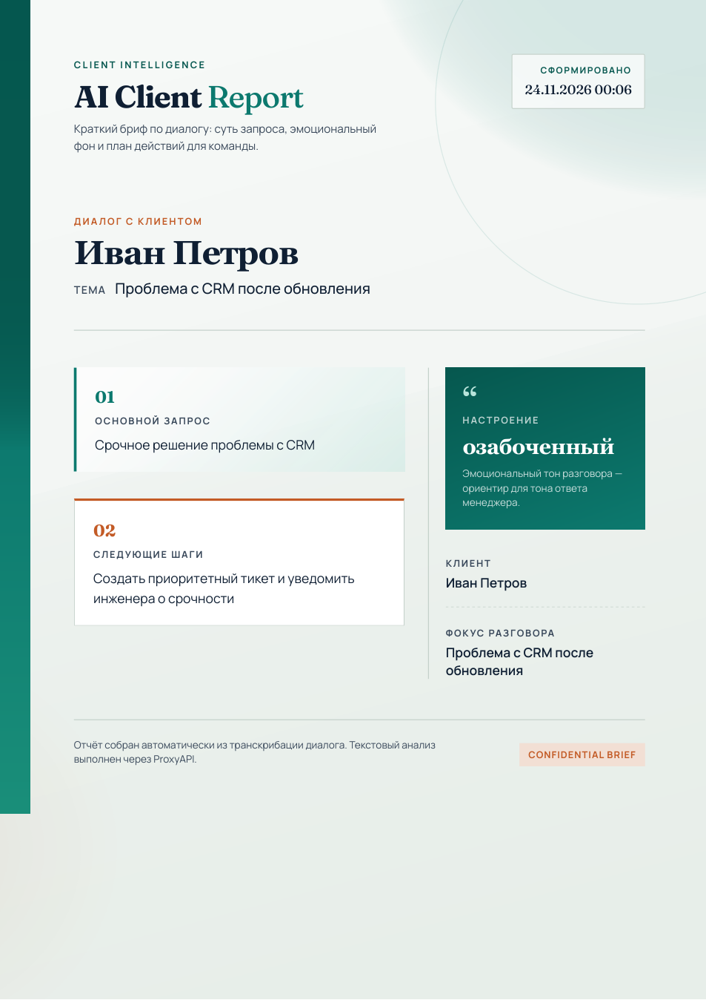

# AI Client Report Generator

Python-инструмент для автоматической генерации PDF-отчётов по транскрибациям диалогов с клиентами.

ИИ через **ProxyAPI** анализирует разговор, сам определяет тип отчёта и собирает готовый PDF из HTML-шаблона (**Jinja2** + **WeasyPrint**). Для обсуждений логотипа дополнительно генерируется AI-пример фирменного знака.

## Возможности

- Анализ транскрибации диалога через ProxyAPI (OpenAI-совместимый API)
- Автоопределение типа отчёта: обычный клиентский или лого-бриф
- Генерация PDF из HTML-шаблонов
- Для лого-отчёта — генерация примера логотипа и вставка в PDF
- CLI и опциональный Flask API
- Логирование и понятная обработка ошибок

## Стек

`Python` · `ProxyAPI` · `OpenAI SDK` · `Jinja2` · `WeasyPrint` · `Flask` · `python-dotenv`

## Типы отчётов

| Тип | Когда выбирается | Результат |
| --- | --- | --- |
| `client` | Обычный диалог с клиентом | PDF с темой, запросом, настроением и next steps |
| `logo` | Обсуждение логотипа / айдентики | PDF-бриф + AI-пример логотипа (PNG) |
| `auto` | По умолчанию | ИИ сам выбирает `client` или `logo` |

## Примеры отчётов

Превью лежат в `docs/previews/` (их можно коммитить в git). Сами PDF из `reports/` в репозиторий не попадают.

### Клиентский отчёт



### Лого-отчёт


### Сгенерированный логотип


## Структура

```
project_root/
├── main.py
├── templates/
│   ├── report_template.html
│   └── logo_report_template.html
├── docs/
│   └── previews/          # картинки для README (в git)
├── reports/               # готовые PDF (в .gitignore)
│   └── logos/             # PNG логотипов (в .gitignore)
├── utils/
│   ├── ai_processor.py
│   └── pdf_generator.py
├── samples/
│   ├── sample_dialog.txt
│   └── sample_logo_dialog.txt
├── .env
└── requirements.txt
```

## Установка

```bash
python -m venv .venv
.venv\Scripts\activate
pip install -r requirements.txt
```

На Windows для WeasyPrint обычно нужны GTK-библиотеки.
См. [документацию WeasyPrint](https://doc.courtbouillon.org/weasyprint/stable/first_steps.html#windows).

## Настройка

1. Скопируйте `.env.example` → `.env` (или отредактируйте уже созданный `.env`).
2. Укажите ключ ProxyAPI:

```env
PROXYAPI_KEY=ваш_ключ
PROXYAPI_MODEL=openai/gpt-4o-mini
PROXYAPI_IMAGE_MODEL=openai/gpt-image-1-mini
PROXYAPI_IMAGE_SIZE=1024x1024
PROXYAPI_BASE_URL=https://api.proxyapi.ru/v1
```

## Запуск

По умолчанию ИИ сам определяет тип отчёта (`client` или `logo`):

```bash
python main.py samples/sample_dialog.txt
python main.py samples/sample_logo_dialog.txt
```

Принудительно задать тип:

```bash
python main.py samples/sample_dialog.txt --type client
python main.py samples/sample_logo_dialog.txt --type logo
```

Ручной ввод:

```bash
python main.py
```

Опциональный Flask API:

```bash
python main.py --serve
```

```bash
curl -X POST http://127.0.0.1:5000/generate ^
  -H "Content-Type: application/json" ^
  -d "{\"text\": \"...\"}"
```

Поле `type` опционально: `auto` (по умолчанию), `client` или `logo`.

Готовые файлы:
- PDF: `reports/report_….pdf` или `reports/logo_report_….pdf`
- PNG логотипа: `reports/logos/logo_….png`

## Логи и ошибки

Логи пишутся в консоль и в `logs/app.log`.

```bash
python main.py samples/sample_logo_dialog.txt --type logo --log-level DEBUG
```

Коды выхода CLI:

| Код | Причина |
| --- | --- |
| 0 | Успех |
| 2 | Конфигурация (`.env`, ключ) |
| 3 | Транскрибация |
| 4 | ProxyAPI / ИИ |
| 5 | Генерация PDF |
| 130 | Прервано пользователем |
